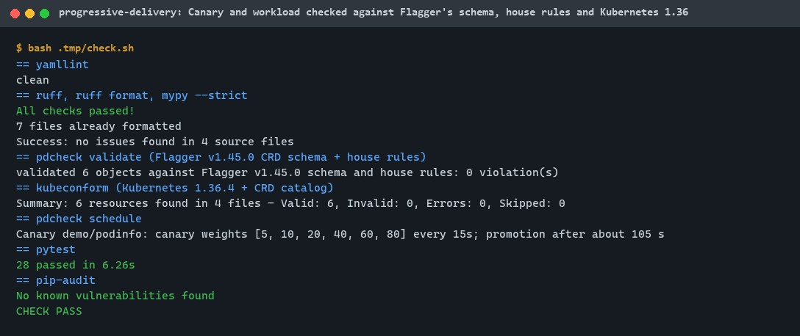
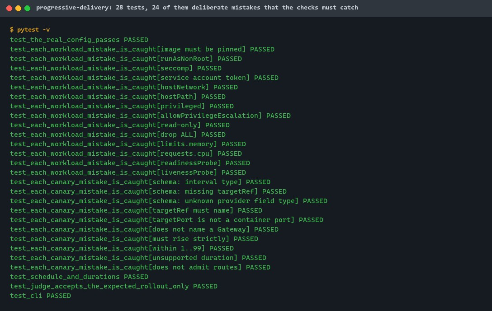
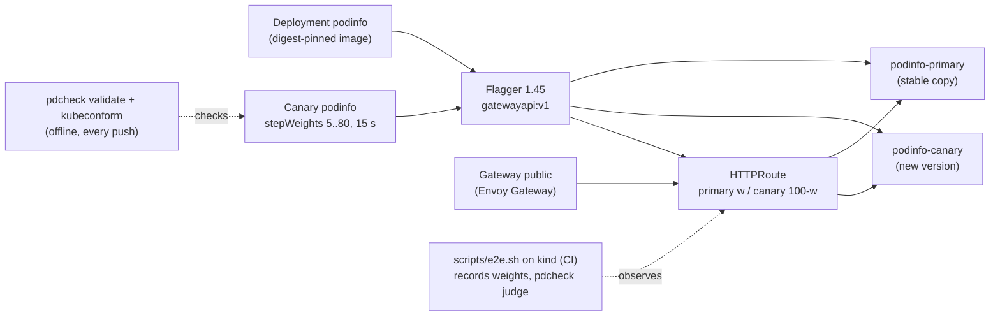
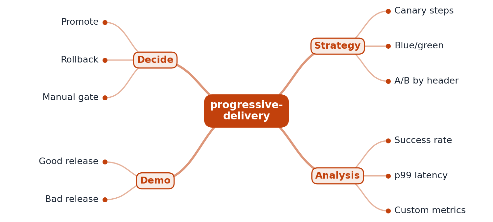

# progressive-delivery

[](https://github.com/EquinoxWN/progressive-delivery/actions/workflows/ci.yml)


> Releases that move traffic to a new version in steps: Flagger canaries on the Gateway API, with the configuration checked against Flagger's schema on every push and a real rollout on kind in CI.

Part of my **DevOps and Cloud** list · YAML

## Proof it works

A Flagger Canary for the podinfo app routes traffic through the Gateway API (Envoy Gateway) and
shifts it to a new image in steps of 5, 10, 20, 40, 60 and 80%, one step every 15 s. The Canary
passes Flagger v1.45.0's own schema, every object passes Kubernetes 1.36 schemas, and the workload
passes the house rules (digest-pinned image, non-root, read-only root, probes, limits):



28 tests pass, 24 of them deliberate mistakes the checks must catch:



The real rollout on a kind cluster (Flagger creates the primary, the HTTPRoute weights move
through the steps, the new image is promoted) is written into CI (`scripts/e2e.sh`). It has
not run yet: this machine uses no Docker. See [Tests and results](#tests-and-results).

## Architecture

**What M1 runs today:**



**Full roadmap (M1 to M3):**



## How it works

_Steps 1 and 2 are built and tested (M1); the rest is on the [roadmap](#roadmap)._

1. You define a Canary resource; Flagger creates a primary deployment and routes traffic between primary and canary.
2. When a new image appears, traffic shifts in steps (5%, 10%, 20% and so on).
3. At each step Flagger queries Prometheus for success rate and p99 latency against thresholds.
4. Healthy metrics keep the rollout moving until promotion; unhealthy ones roll back to the primary automatically.
5. A webhook gate can require manual approval before production.
6. The demo ships one good release and one with injected errors, and records both.

In M1, applying `config/app` gives Flagger a Deployment and a Canary. Flagger copies the
Deployment to `podinfo-primary`, creates the services, scales the original to zero and writes an
HTTPRoute on the shared Gateway (primary 100, canary 0). A new image starts an analysis: one step
per 15 s interval moves the canary's weight through 5, 10, 20, 40, 60 and 80%, then the new spec is
promoted to the primary. M1's analysis has no metrics, so it checks the mechanism, not the release.

## Who it helps

- **Who:** platform and release engineers who want gradual, automatic releases on Kubernetes, and
  people learning canary analysis.
- **The problem:** a rolling update sends everyone to a new version as soon as it passes a health
  check; a canary limits a bad release to a few percent of users, but its configuration fails
  silently until release day.
- **What M1 does:** a working Canary on the Gateway API with an explicit step schedule, and checks
  that catch schema errors, broken references and unsafe workload settings before they are applied,
  plus a CI job that runs a real rollout and judges it against the schedule.
- **How to use it:** copy `config/` and adapt the Deployment and Canary; run `make lint` on every
  change; run `make e2e` on a machine with Docker to watch a rollout.

## Tech stack

| Area | In M1 | Planned |
|---|---|---|
| Delivery | Flagger 1.45.0 (Helm), Canary with explicit stepWeights | Prometheus success-rate and latency checks, automatic rollback (M2); approval webhook (M3) |
| Traffic | Gateway API: Envoy Gateway v1.9.2, shared Gateway, HTTPRoute weights | |
| Workload | podinfo 6.14.0 / 6.15.0 by digest, restricted Pod Security | Good and broken releases with recordings (M3) |
| Checks | pdcheck (Flagger CRD schema, house rules, references, schedule, rollout judge), kubeconform, yamllint | |
| Test cluster | kind v0.33.0, node image by digest, in CI | |

Language: **YAML** (configuration), with **Python** for the checks.

| Path | What it is |
|---|---|
| `config/app` | Namespace, Deployment and Canary |
| `config/gateway` | GatewayClass and the shared Gateway |
| `config/helm` | Flagger chart values |
| `config/kind` | Test cluster definition |
| `src/pdcheck` | Offline checks and the rollout judge |
| `scripts` | Pinned tool downloads; the end-to-end rollout |

## Run it

Needs Python 3.11+, make and bash with curl; `make e2e` also needs Linux with Docker. Downloads
and caches stay in git-ignored `.tmp/`; use a virtual environment.

```bash
python -m venv .venv && . .venv/Scripts/activate   # Linux/macOS: .venv/bin/activate
make setup      # pdcheck, yamllint, ruff, mypy, pytest, pip-audit
make lint       # yamllint, ruff, mypy, pdcheck validate, kubeconform
make test       # 28 tests
make schedule   # the expected traffic steps
make audit      # pip-audit
make e2e        # Linux + Docker: kind, Envoy Gateway, Flagger, a real canary rollout
```

On a cluster you already run (with Envoy Gateway and Flagger installed as in `scripts/e2e.sh`):

```bash
kubectl apply -k config/gateway && kubectl apply -k config/app
kubectl -n demo get canary podinfo -w        # Initialized
kubectl -n demo set image deploy/podinfo podinfo=ghcr.io/stefanprodan/podinfo:6.15.0@sha256:ec73780a8425f59ea49f5bc8cdff0d598805a224fbaa1f86c67a244f250fa9da
kubectl -n demo get httproute podinfo -o jsonpath='{.spec.rules[0].backendRefs}'   # weights move
```

## Tests and results

Latest local run (full detail in [docs/results/m1.md](docs/results/m1.md)):

| Test | Count | What it proves |
|---|---|---|
| `test_the_real_config_passes` | 1 | All six objects pass every check |
| `test_each_workload_mistake_is_caught` | 14 | Tag-only image, root, no seccomp, token mounted, host network, hostPath, privileged, privilege escalation, writable root, capabilities kept, missing limits, requests and probes are each reported |
| `test_each_canary_mistake_is_caught` | 10 | Schema violations, missing target, wrong port, unknown gateway, bad step weights, unsupported duration, a Gateway that refuses the namespace |
| `test_schedule_and_durations` | 1 | Step weights and durations |
| `test_judge_accepts_the_expected_rollout_only` | 1 | The rollout judge fails a skipped step, a rollback, bad route weights and an empty recording |
| `test_cli` | 1 | `validate`, `schedule`, `judge` |

| Check | Result |
|---|---|
| Tests | 28 passed, 0 failed |
| pdcheck validate (Flagger v1.45.0 schema, rules, references) | 6 objects, 0 violations |
| kubeconform (Kubernetes 1.36.4 + CRD schemas) | 6 of 6 valid |
| Lint | yamllint, ruff, mypy --strict: clean |
| Audit | pip-audit: no known vulnerabilities |
| Schedule | canary 5, 10, 20, 40, 60, 80% every 15 s; promotion after about 105 s |
| Real rollout on kind | CI only, not run yet (no local Docker) |

CI runs the checks, tests and audit on every push, then the kind rollout, which prints a notice
at initialization and at promotion with the observed weights.

## Roadmap

**M1** (≈8 h)
- [x] Write `docs/rfc/0001-design.md`: problem, goals, non-goals, chosen design
- [x] You define a Canary resource; Flagger creates a primary deployment and routes traffic between primary and canary.
- [x] When a new image appears, traffic shifts in steps (5%, 10%, 20% and so on).

**M2** (≈8 h)
- [ ] At each step Flagger queries Prometheus for success rate and p99 latency against thresholds.
- [ ] Healthy metrics keep the rollout moving until promotion; unhealthy ones roll back to the primary automatically.

**M3** (≈9 h)
- [ ] A webhook gate can require manual approval before production.
- [ ] The demo ships one good release and one with injected errors, and records both.
- [ ] Publish the proof below with real numbers

M1 is configured, validated offline and wired into CI; the first real rollout happens in CI.

## Proof

What this repo must show before it counts as done:

- Two recordings, auto-promote and auto-rollback, with the metric panels that drove each decision.

| Result | Value |
|---|---|
| Auto-promote and auto-rollback recordings with metric panels | Not yet (M2 metrics, M3 recordings) |

## Why it matters

- **Interview angle:** 'Release safely to millions of users'.
- **Upstream I'd like to contribute to:** Flagger or OpenKruise Rollouts (Alibaba).

## Design docs

- [RFC 0001: design](docs/rfc/0001-design.md)
- [ADR 0001: record architecture decisions](docs/adr/0001-record-architecture-decisions.md)
- [ADR 0002: shift traffic through the Gateway API, served by Envoy Gateway](docs/adr/0002-gateway-api-with-envoy-gateway.md)
- [M1 results](docs/results/m1.md)

## Scope

This is a learning and portfolio system, not a hosted production service. The rollout runs on a
throwaway kind cluster that is deleted after each run.

## Security and contributing

- The app runs under `restricted` Pod Security: non-root, seccomp, no privilege escalation,
  capabilities dropped, read-only root, no service account token, requests and limits.
- Images and the kind node image are pinned by digest; Flagger's CRD, kind, kubectl, Helm and
  kubeconform are pinned by version and SHA-256; charts by version.
- The Gateway admits routes only from the app's namespace; the CI cluster is deleted on exit.
- Every GitHub Action is pinned to a commit SHA; workflows run read-only, without persisted credentials.
- Dependabot update pull requests are paused (`open-pull-requests-limit: 0`) so the repository keeps a single `main` branch; dependencies are updated by hand and checked by the CI audit.
- yamllint, ruff, mypy, pdcheck and kubeconform on every push; pip-audit (`make audit`) in CI.
- Report vulnerabilities privately: see [SECURITY.md](SECURITY.md). To contribute, see [CONTRIBUTING.md](CONTRIBUTING.md).

## License

MIT, see [LICENSE](LICENSE).
